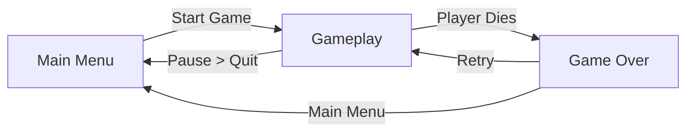
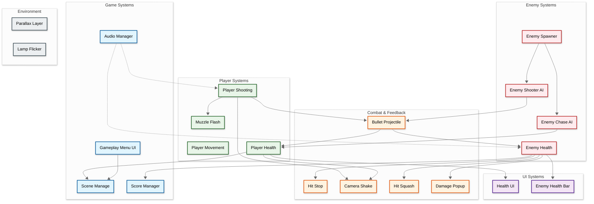
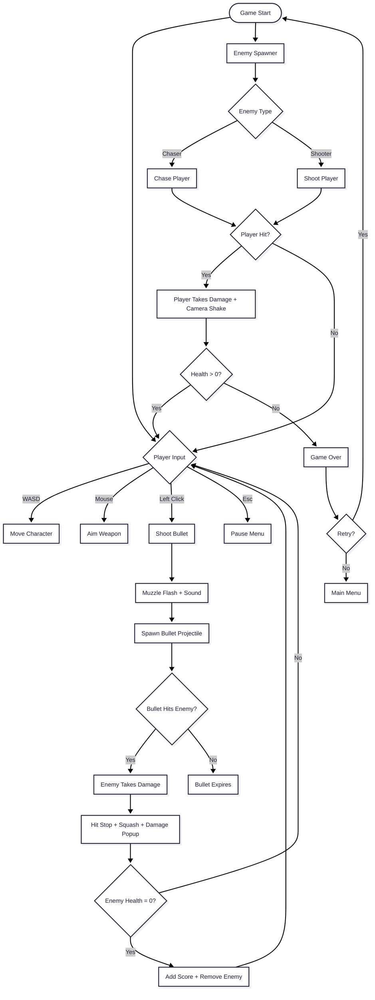
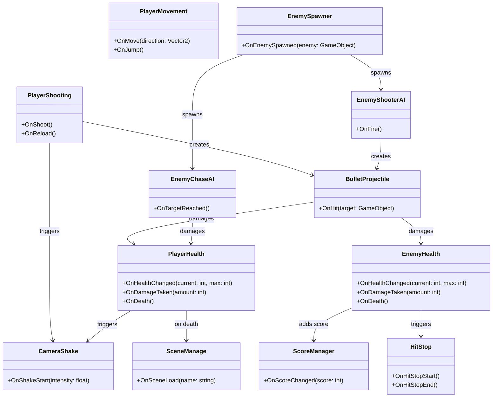

## Developer & Contributions
Jevon (Game Programmer)

## About
Endless Front is a fast-paced action shooter where players move, aim, and shoot their way through waves of enemies. Chasing enemies close in, shooter enemies attack from range, and every hit is backed by juicy feedback like hit stop, camera shake, squash reactions, and floating damage numbers. Survive the onslaught, rack up your score, and stay alive as long as you can.

 

## Key Features

**Responsive Shooting System**: Aim and fire projectiles with muzzle flash feedback, bullet projectiles, and satisfying impact effects on every hit.

**Smart Enemy Variety**: Face enemies with different behaviors, from melee chasers that hunt you down to shooters that keep their distance and fire back. An enemy spawner keeps the pressure on.

**Game Feel & Juice**: Hit stop, camera shake, hit squash animations, and damage popups make every hit feel impactful and readable.

**Atmospheric Visuals**: Parallax scrolling backgrounds and flickering lamps give the world depth and mood.

## Scene Flow

## Layer / Module Design

## Modules and Features

The action gameplay, enemy AI, combat feedback, and UI are powered by a modular Unity C# scripting system organized into `Player`, `Enemy`, and `Game` folders.

| 📂 Name | 📁 Folder | 📋 Responsibility |
|---------|-----------|-------------------|
| **PlayerMovement** | **Player** | - Handle player movement input - Control speed and direction - Handle facing and ground/air logic |
| **PlayerShooting** | **Player** | - Handle aiming and fire input - Spawn bullet projectiles - Manage fire rate and cooldown - Trigger muzzle flash and shoot effects |
| **PlayerHealth** | **Player** | - Track player health (current/max) - Handle damage and invincibility - Trigger death and game over - Update health UI |
| **MuzzleFlash** | **Player** | - Display muzzle flash on shooting - Control flash duration and visibility |
| **EnemyChaseAI** | **Enemy** | - Pursue the player - Deal contact damage - Handle movement toward target |
| **EnemyShooterAI** | **Enemy** | - Keep distance from the player - Fire projectiles at the player - Manage attack cooldown |
| **EnemyHealth** | **Enemy** | - Track enemy health points - Handle damage from player bullets - Trigger death, score, and cleanup |
| **EnemyHealthBar** | **Enemy** | - Display enemy health bar - Update bar fill in real time |
| **EnemySpawner** | **Enemy** | - Spawn enemies over time - Control spawn positions and rates - Manage enemy types and wave pacing |
| **HitSquash** | **Enemy** | - Play squash and stretch reaction on hit - Give impact feedback to the player |
| **AudioManager** | **Game** | - Play music and sound effects - Manage volume and audio clips |
| **BulletProjectile** | **Game** | - Move projectiles and detect collisions - Apply damage on hit - Handle lifetime and cleanup |
| **CameraShake** | **Game** | - Shake the camera on impacts - Control intensity and duration |
| **DamagePopup** | **Game** | - Show floating damage numbers - Animate and fade out popups |
| **GameplayMenuUI** | **Game** | - Handle pause and game over menus - Manage resume, retry, and quit buttons |
| **HealthUI** | **Game** | - Display player health in the HUD - Update when health changes |
| **HitStop** | **Game** | - Briefly freeze time on impact - Add weight to hits |
| **SceneManage** | **Game** | - Load and reload scenes - Handle transitions between menu and gameplay |
| **ScoreManager** | **Game** | - Track and display score - Add points when enemies are defeated |
| **ParallaxLayer** | **Root** | - Scroll background layers at different speeds - Create depth in the scene |
| **LampFlicker** | **Root** | - Randomly vary lamp light intensity - Add atmosphere to the environment |

 

## Game Flow Chart

 

## Event Signal Diagram

 

## Play The Game
<a href="YOUR_ITCH_IO_OR_GAME_LINK">Play Now</a>

 

## Installation & Setup
1. Clone this repository
2. Open the project in Unity (version used in your project recommended)
3. Open the main gameplay scene
4. Press Play to start testing

## Controls
- **WASD** - Movement
- **Mouse** - Aim
- **Left Click** - Shoot
- **Escape** - Pause Menu

## Credits
Game developed as a Game Programming Project Individually.
